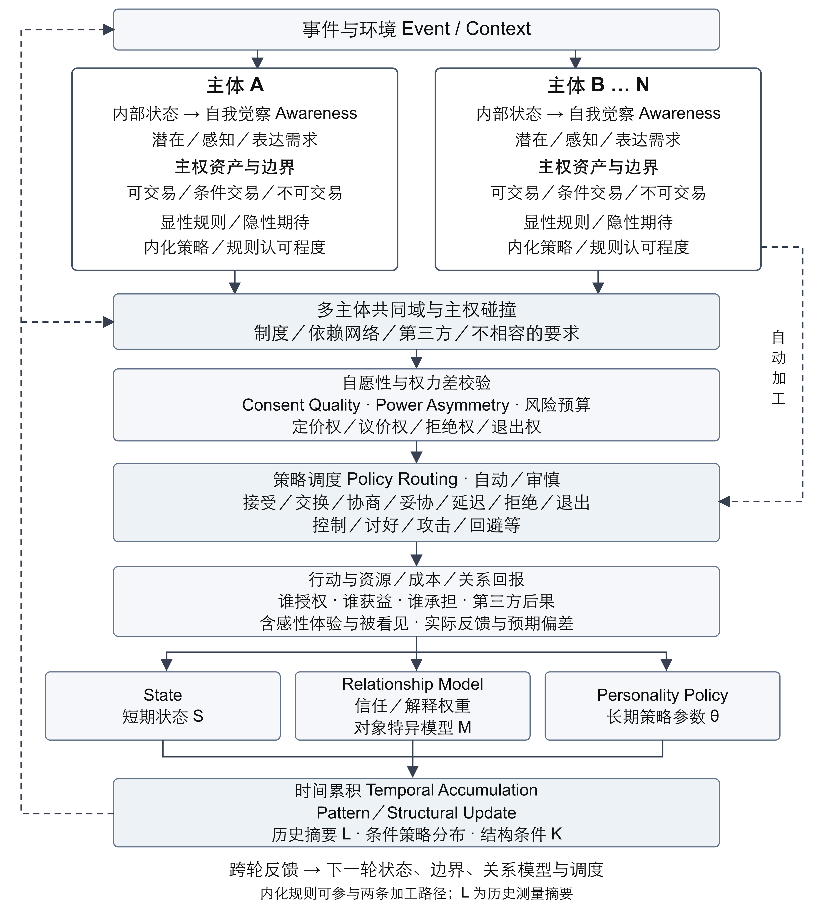

# 多主体互动中的人格调度：自主性、资源配置与动态更新

Personality Regulation in Multi-Agent Interaction: Autonomy, Resource Allocation, and Dynamic Updating

作者：朱洁冰

理论框架修订稿 · V3 · 2026 年 9 月 30 日

## 摘要

同一种外显行为可能服务于不同目标，同一主体在状态、关系与约束改变时也会调用不同策略。仅凭行为标签或固定人格特质，难以说明这些差异如何产生、成本由谁承担，以及反馈应更新哪一层模型。本文提出一个多主体互动中的人格调度框架，用于描述和分析多主体交互中的策略选择及其后果。框架由三部分构成：主体的状态、自我觉察与授权边界；共同域中的同意质量与权力不对称；策略调度、成本流向及多时间尺度更新。模型将人格表征为状态、环境、关系权重与约束下的相对稳定条件概率结构；当前形式化和检验聚焦行为策略选择，感知、解释与估值作为待展开的接口。框架区分内化规则的内容及认可程度与自动／审慎加工方式，也区分授权、资源支出与净损失，允许给予的意义与“被看见”本身构成收益。科斯的权利配置与交易成本分析构成交换机制的理论基础；框架进一步提出将这些条件与状态、授权质量及跨轮更新联合编码。本文通过概念辨析与既有理论整合提出框架，并以假设情境说明其编码方式，尚未进行经验验证。文中给出模型定义、案例卡编码方案、变量操作化、七项可被反驳的命题及分阶段验证设计。本文的贡献是提出一个可编码、可比较的整合结构；其预测效度、跨情境适用性及相对于较简单模型的增量价值有待独立数据检验。

关键词：主权；人格调度；多主体交互；自我觉察；同意质量；权力不对称；内化策略；时间累积

## Abstract

The same overt behavior can serve different goals, and the same person may invoke different strategies as state, relationship, and constraints change. Behavioral labels or fixed traits alone cannot explain how such differences arise, who bears the costs, or which level of a model feedback should update. This paper proposes a descriptive and analytic framework for personality regulation in multi-agent interaction, focusing on strategy selection and its consequences. It integrates (a) each agent’s state, self-awareness, and authorization boundaries; (b) consent quality and power asymmetry in a shared domain; and (c) policy routing, cost flows, and updating across multiple timescales. Personality is represented as a relatively stable conditional probability structure under given states, environments, relational weights, and constraints. The present formalization and proposed tests focus on behavioral strategy selection; perception, interpretation, and valuation remain interfaces for further specification. Internalized rules and their endorsement are distinguished from automatic or deliberative processing. The framework distinguishes authorization, resource expenditure, and net loss, and allows that the meaning of giving, and being seen, may themselves be benefits. Coasean analysis of rights allocation and transaction costs grounds the exchange mechanism; the framework proposes to code these conditions jointly with state, consent quality, and updating across interactions. The framework is developed through conceptual analysis and theoretical integration. Hypothetical scenarios illustrate its coding scheme; empirical validation remains to be conducted. The paper offers model definitions, a case-card coding scheme, operationalizations, seven falsifiable propositions, and a staged validation design. Its contribution is an integrative, codable structure; predictive validity, cross-situational applicability, and incremental value over simpler models remain to be tested with independent data.

Keywords: sovereignty; personality policy routing; multi-agent interaction; self-awareness; consent quality; power asymmetry; internalized policy; temporal accumulation

## 1 引言

人格研究需要同时解释稳定与变化：一个人为何会在某些关系中持续协商，在另一些关系中迅速退出；为何同样的长篇表达，有时为了取得理解，有时为了完成自己的思考；又为何短期让步可能是自主选择，长期持续让步却可能与退出能力的下降共同出现。将这些现象归结为“理性”“依赖”或“控制欲”等标签，容易跳过行为发生的条件，也无法从标签本身推导下一次行动。

本文讨论主体如何对身体、时间、注意力、信息、资源和决策权限进行配置，以及这些配置如何在与其他主体的交互中受到支持、争议或限制。框架面向不同生活领域的互动，不预设所有活动均可还原为交易。“主权”在本文中是针对个人授权边界及其实际可行性的工作性术语，不是国家主权的直接移植。模型的基本问题是：当一个主体的目标需要他人的参与、资源或授权时，各方怎样识别需求、估计约束、调用策略，并把结果写回后续调度？

本框架沿着主体内部状态、自我觉察、边界识别、规则与期待激活、多主体主权碰撞、自愿性与权力差校验、策略调度、行动与成本流向、分层更新、时间累积的路径展开。该路径是分析上的功能分解，不是假定大脑中存在一条逐站执行的串行程序。快速习惯、认知负荷与强制环境均可能使主体绕过部分显性检查；研究者仍可事后编码这些缺口，但不能因此认定主体当时完成了相同的计算。

本文主张的贡献有三个。第一，以“谁授权、谁受益、谁承担、谁能拒绝和退出”将内部策略与多主体后果连接起来。第二，区分短期状态、对象特异的关系模型与相对长期的策略参数，避免把一次事件直接解释为人格改变。第三，为未来交互研究与人格调度系统提供保留不确定性的事件编码接口。这些贡献是整合和操作化提案，并非对交换、权利配置、交易成本、动态人格或反馈学习的首次发现。新增价值应体现在这些条件如何共同预测策略进入、停止与跨轮变化，而非为已有概念更换名称。

本文是理论初稿，不报告预注册实验、统计估计或已获验证的计算系统。示例仅用于说明可如何编码；后文研究设计均为拟议方案。将控制、讨好或攻击纳入策略集合，是为描述可能发生的行为，不表示这些行为正当，也不将模型作为关系相处手册。

## 2 概念与相关工作

### 2.1 能动性与自主性

Bandura 将能动性置于个体与社会结构相互作用之中，强调意向、前瞻、自我调节与反思，并区分个人、代理和集体能动性[1]。Ryan 与 Deci 的自我决定理论将自主、胜任和联结纳入动机解释，区分自主调节与受控调节[2]。因此，自主性不等于不依赖别人，接受帮助、委托决策和关怀他人可以与自主性相容。

本文在此基础上，将主权区分为三个层面：主体提出的授权主张、环境实际允许的控制能力，以及研究或制度采用的规范边界。三者不必一致。一个人可以认为自己有拒绝权，却因经济依赖难以行使；也可以客观上具有退出条件，却因习惯性默认反应不把退出看作选项。本框架的“主权”是这三层的分析入口，不是已经完成构念验证的新心理量表。

### 2.2 社会交换与共同性关系

Homans 从交换角度连接行为、影响和群体结构问题[3]；Cropanzano 等梳理社会交换研究的概念问题并提出理论修正[4]。本框架因而不能把“行为涉及收益和成本”当作独创发现，也不宜把一切事后选择重新命名为收益最大化：若任意行动都能被赋予一个事后收益，模型就失去排除错误解释的能力。

Molm 等区分交换的工具价值与互惠行动的象征价值[5]，提示资源之外还存在关系意义。Clark 与 Mills 对交换关系和共同性关系的区分则构成重要限制：共同性关系可以根据他人的需要给予，而不要求逐笔对等回报[6]。因此，本文以“资源与授权配置”为母概念，以交换为其中一种关系形式；给予、照料、共同创造和委托不必全部编码为隐性买卖。感性本身可以是收益，但研究者必须在行动前或独立测量中识别这种价值，不能用“他必然得到满足”消解任何代价。

### 2.3 科斯分析中的权利配置与交易成本

科斯在《社会成本问题》中以外部性冲突分析权利界定与协商安排[7]。零交易成本条件下的协商结果可作为效率基准，但不能直接当作现实互动规律。所谓“科斯定理”存在不同表述；效率命题与“最终配置不受初始权利归属影响”的不变性命题应分开，后者需要处理财富效应等附加条件[8]。即使配置相同，补偿方向与收益分配也可能不同，不能由效率推导公平。

科斯对现实问题的分析强调，寻找交易对象、传达条件、协商、订约及检查履约均消耗资源；存在这些成本时，初始权利安排与组织方式会影响哪些调整能够实现[7]。本文据此将权利归属、调整安排的成本与实际资源流向连接起来，而不把“只要双方沟通就能解决冲突”作为前提。

这一对接具有范围限制。本框架的主权包含授权主张、实际能力与规范边界，不能整体等同于可转让产权。只有在相关权限允许调整时，才分析协商及其成本；不可交易边界不因潜在总收益较高就自动开放。权力差与同意质量也需独立记录，成交本身不能证明没有强制。本文提出的整合问题是：在已知权利和交易条件之外，状态、觉察、内化规则与关系历史是否还能预测主体会否进入协商、何时停止以及下一轮如何选择。

### 2.4 相互依赖与权力依赖

相互依赖理论分析情境结构如何限定行为机会，并通过动机转换解释主体如何把长期目标或对方福祉纳入行动[9]。Emerson 的权力依赖分析强调，权力是关系属性，与一方对另一方的依赖相联系[10]。这些理论已经包含情境、依赖与适应，本文不能把它们描述为单纯静态的成本收益理论。

本框架进一步把定价、议价、拒绝和退出的实际能力分别记录，并将双人互动扩展为可能涉及第三方的共同域。同一行动可以改善 A 的状态，却把劳动、风险或机会成本转移给 B、C。本文据此提出多主体成本归属与授权范围的联合编码，而不假设双方收益可以相加成一个天然合理的总收益。

### 2.5 信任与被看见

Mayer、Davis 与 Schoorman 将信任与愿意承受脆弱性相联系，并区分能力、善意与正直等前因[11]。据此，信任不能与对方客观可靠性、信息正确率或验证次数画等号。本文将降低验证投入视为信任可能带来的一个行为后果；减少验证也可能来自疲劳、无力或信息不可得，必须通过独立指标加以区分。

亲密过程研究将自我披露、对方披露与感知到的伴侣回应性（perceived partner responsiveness）联系起来[12]。“被看见”在本文中是体验性用语，指主体感到自己的具体处境得到理解、承认和关切；其内容与感知回应性高度重叠，本文不预先主张它构成独立的新心理构念。测量上应分开记录三类变量：主观回应体验、对方行动与已表达需求的匹配程度，以及随后发生的具体授权。前者可优先使用适合研究情境的既有回应性测量；第二类由独立行为编码获得；第三类记录披露范围、委托事项、有效期及停止选择。行为匹配不是主观体验的定义组成，感到被理解也不能替代实际授权。

本文提出，被看见是亲密关系中愿意开放部分信息、时间与决策权限的重要回报之一。它不保证让渡有收益，也不是所有主体的首要回报。陪伴、身体愉悦、安全、照料、共同目标以及给予本身的意义，都可能具有独立价值。

### 2.6 依恋与心智化

Hazan 与 Shaver 将成人亲密联系与依恋过程联系起来[13]。Fonagy 与 Luyten 对心智化的分析提示，自我与他人心理状态的区分、自动与受控处理之间的关系具有理论意义[14]。后者主要来自特定临床问题的研究，本文只借用其过程性区分，不据此推断个体诊断或将临床结论直接推广到一般人群。

依恋相关预期可以影响关系威胁的感知及对退出的估计，但不能被简化成“某类型必定讨好或回避”。同样，理解他人为何行动，不等于同意其要求，更不等于有义务替其承担成本。本框架将对方模型、对其行动的价值判断以及自己是否授权分别保留，防止心智化能力被误写为顺从倾向。

### 2.7 同意与实际选择空间

Muehlenhard 等对性同意研究的概念与经验综述，强调意愿、表达、沟通与情境之间的复杂关系[15]。本文据此区分同意表达、主观意愿与同意条件，但将这些区分推广到工作、照料等领域仅属待验证的跨域提案。同意质量（Consent Quality）是本文提出的多维记录框架，不是该文献中已经确立的通用指数，也不能代替任何领域的同意要求。

同意质量按第 5.2 节的六个维度记录；其中知情、可行替代、拒绝后果和撤回条件构成筛查用的最小四问。研究者对证据的置信度是另一变量：高质量同意可能缺少记录，低质量同意也可能有充分证据。二者不能合并成“同意概率”。

### 2.8 有限理性、内化策略与加工方式

Simon 的有限理性路径为受信息、时间和能力约束的决策提供基础[16]。习惯研究说明重复情境中的反应可以变得自动化，并与目标追求共同作用[17]。但内化策略（Internalized Policy）与自动路径属于不同分析维度：前者指通过学习形成的规则、价值和行动倾向，后者指这些表征如何被调用。本文将内化策略作为规则表征及人格策略参数 θ 的可编码内容，不另设一个未经识别的执行模块。自我决定理论对内摄、认同与整合的区分提示，规则进入个体调节过程并不意味着获得相同程度的自主认可[2]。

自动路径指线索触发、较少依赖当下审慎评估的加工方式，其中习惯是重要来源，但不能把所有自动反应都归为习惯。自动和审慎路径都可能调用内化规则；主体也可能经过反复思考，仍受羞耻、角色义务或惩罚预期支配。因此，案例需分别记录内化内容及来源、认可程度、行为自动性和修改规则的现实能力。自动妥协可能来自熟练协作，也可能来自受控调节；自动性本身不能判定自愿性。

### 2.9 人格动力学与学习模型

Mischel 与 Shoda 的认知情感系统理论强调情境与行为之间相对稳定的条件关系[18]；Fleeson 以状态的密度分布刻画人格表现中的个体内变化与个体间稳定性[19]。Whole Trait Theory 将这种描述与社会认知解释联系起来[20]，DeYoung 的控制论人格理论则以目标、反馈及适应机制讨论人格结构[21]。本文关于“稳定概率结构”的主张与这些传统相容，不等于否定特质量表的描述价值。

强化学习为策略、反馈和状态转移提供可比较的计算语言[22]，但本文不假定人的奖励已经给定、状态完全可观测或社会环境平稳。仅凭交互前后的行为变化，不足以确定主体使用何种学习算法。本框架的最小承诺是定义可记录的输入、策略和更新对象；具体算法需要通过模型比较选择。

### 2.10 过程报告与外部认知支撑

Nisbett 与 Wilson 对心理过程言语报告的讨论指出，自我解释可能依赖事后因果叙事[23]。这对未来测量提出限制：主体报告的目标、解释与感受是重要信息来源，但不能被视为对生成机制的直接读取。过程报告需要与行为时序、情境操纵及其他独立测量结合，才能区分相互竞争的解释。

表达也可能承担外部化思考的功能。扩展心智研究为考察认知与外部支撑之间的关系提供背景[24]，但仅凭长篇表达不能认定心智已经“扩展”。本文提出一个更有限的问题：不同任务目标是否改变反馈的用途和表达的停止条件，以及这种差异能否预测后续行为。

## 3 模型定义

### 3.1 分析单位与共同域

设共同域中存在 n 个主体，每个主体以 i 标识。一次事件窗口由外部触发、各方观察与响应、后果记录和局部停止条件组成；t 表示窗口序号，而非固定时长。共同域包括关系网络、制度规则、资源条件及所有受到行动影响的人。未参与协商但承担后果的第三方仍属于分析范围。组织可以作为有授权程序的集体行动者，但不能因此掩盖成员间成本差异。

单个主体的内部状态 S 包含疲劳、唤醒、威胁感、需求显著性及可用资源等快变量。以 i 表示正在观察和更新判断的主体，以 j 表示关系对象；Mᵢ→ⱼ 表示主体 i 对对象 j 的能力、意图、可预测性和边界尊重程度的估计，Mᵢ 表示这些对象特异模型的集合。人格策略参数 θ 表示跨事件相对稳定的调度倾向；当前可估计部分主要是策略偏好与触发关联，感知、解释和估值机制仍待细化。结构条件 K 表示可行选项、依赖网络、资源控制及制度约束。分析上将它们分开，经验上允许相互影响。

$$
Z_t=(K_t,\{S_{i,t},M_{i,t},\theta_{i,t}\}_{i=1}^{n}) \qquad (1)
$$

式（1）是全局生成状态的记号；任何主体或研究者通常只能看到其中一部分。主体依据自己的观察与历史形成信念 b，而不是直接读取 Z。若观测不足以支持独立估计，模型应合并变量或标为未识别，不以增加潜变量来掩盖预测失败。

### 3.2 主权资产与边界

主权资产指与主体的控制、授权或拒绝相关的资源及权限，包括身体与信息边界、时间、注意力、金钱、劳动、情绪投入、身份表达、未来选择以及决策参与。“资产”是记录用词，不意味着人格和身体可以被所有权式出售。让渡在本文中指特定范围内的授权（许可或委托），不意味着永久转让主体资格；资源支出另行记录，二者可以分离。

边界 B 按具体行为、对象、期限与条件分为可交易、条件交易和不可交易。例如，允许讨论某段经历不自动包括公开传播；同意一次委托不自动覆盖以后所有决策。不可交易边界必须分别记录“主体自定”“关系约定”“制度规定”或“研究伦理要求”的来源。即使现实中出现越界，描述模型仍需解释它如何发生；规范边界的存在不能被误当作越界在事实上不可能发生。

定价权指提出自己愿意接受的投入与条件，议价权指影响这些条件的能力，拒绝权指不接受某一要求的资格及现实空间，退出权指停止某项互动或离开关系的资格及可行路径。它们不是四个同义词：可以允许拒绝单项任务，却让退出关系代价极高。授权主张、主体对自身能力的主观估计、外部实际可行性与规范边界应当分别编码。

在可调整权限的情境中，应进一步区分初始归属与实际授权：初始归属说明未达成新约定时谁能作决定，实际授权说明本轮发生了什么改变。对默认安排的沉默不等同于授权。制度赋予的权限、各方认为有效的权限与争议中的主张均需保留，不能为满足产权清晰的分析条件而抹去现实分歧。

### 3.3 觉察与需求表征

自我觉察（awareness）不是对“真正自我”的完全访问，而是主体觉察感受、辨识需求、发现冲突及校准自身判断的能力与当下过程。模型区分潜在需求、感知需求和表达需求。所谓潜在需求是解释性潜变量，不能由研究者凭叙事权威填入；感知需求来自当事人的自我报告；表达需求则是实际提出的请求。表达差异可能源于尚未觉察，也可能源于策略性沟通或不安全的表达环境。

觉察提高后，主体可能修改对过去行为的理解，但这种修改本身也是新的观察材料。后来的后悔不能单独证明原先毫无意愿，原先说“愿意”也不能证明当时拥有足够信息和安全的拒绝空间。

### 3.4 显性规则、隐性期待与内化策略

显性规则是可核对的约定或制度；隐性规则是各方未明说的期待，未必共享；内化策略是主体已学习的规范、价值及行动倾向。三者可以交叠：一项显性制度可以被内化，一项内化义务也可能从未被双方共同认可。未经沟通的期待不能自动构成他人的义务。案例记录需保存规则内容、来源、触发线索、认可程度和反例，并将自动／审慎加工方式另列。内化内容在模型中由规则表征与 θ 的相关参数承载，不因其被自动调用就归为独立规则层，也不因其经过反思就不再属于内化内容。

### 3.5 策略与后果

策略集合包括接受、交换、协商、妥协、延迟、拒绝、退出、控制、讨好、攻击和回避，也允许修复、求助、委托或探索等域内扩展。各标签并非天然互斥。例如，主体可能先解释再协商，随后拒绝；讨好是一种可能的功能模式，微笑或同意只是行为，二者不能直接等同。编码时记录“主策略＋辅策略＋时间顺序＋置信度”，或采用多标签模型。

策略 p、行动 a 与后果 y 分属不同层级：协商是策略，提出条件是行动，条件是否改变是后果。身体疲劳、意义体验或关系改变是后果变量，不宜因其出现就倒推出某个策略动机。

### 3.6 核心概念图

图 1 多主体互动中的人格调度框架 的功能结构。实线表示本轮主要分析路径，虚线表示自动加工旁路及跨轮反馈。内化规则可参与自动与审慎两种加工；旁路不表示只有自动加工才使用内化内容。各主体具有独立状态与边界，第三方通过共同域进入分析。图示顺序不是已验证的心理执行顺序。

图 1 顶部为各主体的内部状态、觉察、边界和规则表征，随后进入由制度和关系网络共同限定的交互空间。主权碰撞是请求、授权或成本归属不相容的候选点，可以通过合作协调，也可能演变为单方支配。校验层考察自愿条件、权力差与风险，并记录主体是否实际开展检查；自动加工可绕过部分显性检查，审慎加工也不保证检查充分。行动后的反馈分别用于 S、对象特异的 M 和 θ，并可能改变结构 K。累积经历与条件行为模式帮助分析跨轮变化，L 只是相应历史的测量摘要，不能被当作独立施加因果作用的心理实体。图中的主体加工与研究者外部编码须在案例中明确区分。权利的初始归属由边界、规则与结构 K 共同记录；交易成本贯穿条件搜寻、协商和履约过程，并进入行动成本记录。它们是现有节点的分析维度，不另设必须依次通过的心理模块。

## 4 动态机制与状态转移

### 4.1 从触发到策略调度

外部事件首先经过注意与解释，并与当下状态、关系模型、边界和规则共同形成候选行动。可用策略集合与主体认为可用的集合可能不同：实际能够拒绝的人可能不把拒绝视为选项，实际缺乏退出条件的人则可能高估退出能力。模型因此保留现实可行集与感知可行集，而非用一个“选择自由”分数取代两者。

作为一种可检验的参数化方案，策略分布可写为自动路径与审慎路径的混合：

$$
\pi_{i,t}(p)=\lambda_{i,t}\pi^{auto}_{i,t}(p)+(1-\lambda_{i,t})\pi^{del}_{i,t}(p) \qquad (2)
$$

其中 λ 表示自动路径的相对权重，取值在 0 与 1 之间；两条路径都以当时的信念、边界、关系和情境为条件。式（2）是建模候选，并不是已识别的认知模块。若缺乏时间压力操纵、反应时或过程测量，λ 往往无法与普通策略偏好区分，此时应退回单一路由模型。两条路径均以人格策略参数 θ 为条件：θ 决定线索与策略之间的默认关联强度，以及审慎路径中的估值倾向。

审慎路径可采用有限选项搜索或满意化机制，不必假定效用最优；一个便于估计的比较模型是以策略预期价值 V 与认知执行成本 c 的差生成 softmax 分布。自动路径可由线索与习惯激活；内化的规范和价值也可能参与两条路径的候选生成及估值。两者均可能产生不符合主体长期目标的行动。高唤醒、疲劳或熟悉情境可能改变混合权重，这些方向只能作为具体研究中的假设，不是对任何个体的预设判断。

### 4.2 收益向量与让渡的价值

行动产生的后果可按物质资源、时间、疲劳、风险、情绪体验、意义、联结及未来选择空间分别记录。预期后果与实际后果也需要分开。主体可能愿意投入时间照料他人，同时体验到疲惫和意义；这不是数据矛盾，而是不同维度的结果并存。

“让渡≠损失”意味着特定范围的授权与净损失判断在逻辑上不同；资源支出是另一变量，同样不能直接等同于净损失。一次自愿委托可能节约决策负担，一次付出可能实现当事人珍视的关系价值。但不能由此推导出“凡自愿皆获益”：主体会误判、受骗或在未来偏好变化后重新估值。正向体验也不抵消已发生的越界，成本存在更不必然证明当时没有获得情感收益。

若研究需要将多个维度聚合为价值，应先说明权重如何独立获得，允许不可比较项和非补偿性约束，并进行敏感性分析。本文不预设跨主体通用货币，也不将被看见、尊严与金钱按固定比率兑换。尚无可识别权重时，保留后果向量比计算虚假的净收益更合适。

本文将交易成本限定为达成或实施某项可调整安排所需的搜寻、信息传递、协商、监督和执行投入。原任务本身的劳动、转移给对方的补偿、拒绝后的惩罚与离开关系的转换成本另列；若同一支出具有多种功能，保留同一事件索引，避免相加时重复计算。认知执行成本 c 也不等于全部交易成本。情绪不适只有在能对应到具体协商或履约活动时才作为相关过程负担记录，不能把所有痛苦重新命名为交易成本。该划分是本文的操作化约定，具体测量仍需验证。

### 4.3 解释权与信任更新

解释权涉及谁能提出、修正或拒绝关于主体经验和身份的解释。外部评价是可检验的输入，其关系亲密程度不自动决定证据质量；主体对自身感受有特殊的报告位置，也不意味着其关于外部事实或行为原因的判断不可纠正。模型将“我接受你的解释”与“你的解释在事实上成立”分开处理。

来源权重可根据领域相关性、历史准确性、可用样本、时效、利益冲突及是否愿意更新来估计。这些因素可能相互关联、量纲不同且含有缺测，因此本文不采用未经标定的乘积公式。信任须按领域和对象区分：相信某人的善意，不等于相信其记忆准确或授权其替自己作决定。

一种待检验的正反馈是：匹配处境的回应提高被看见感，促进领域特异信任，继而增加自愿披露，使对方获得更多校准信息。相应负反馈可能由持续不匹配引发，造成权重下降、披露减少及进一步误解。两种循环均非必然：外部支持、澄清或关系修复能够改变路径，披露过多也可能增加风险。被看见的提升究竟来自真实校准、礼貌迎合还是选择性注意，必须独立检验。

### 4.4 行动后的三层更新

全局转移依赖各方联合行动及结构环境，而不仅是单个主体的行动：

$$
Z_{t+1}\sim T(Z_{t+1}\mid Z_t,\boldsymbol{a}_t,E_t) \qquad (3)
$$

E 表示未纳入结构状态的外部冲击，联合行动向量 a 包含各参与者的行动。式（3）仅在纳入充分状态和历史摘要后才近似具有马尔可夫性质；否则需采用历史依赖、半马尔可夫或部分可观测模型。互动同时发生和反馈延迟也需在事件窗口内明确表示。

为防止不同时间尺度混淆，本文建议区分以下更新对象：

$$
S_{i,t+1}=f_S(S_{i,t},\boldsymbol{a}_t,y_{i,t},\Delta t) \qquad (4)
$$

$$
M_{i→j,t+1}=f_M(M_{i→j,t},o_{i←j,t+1},y_{i,t},\kappa_{i←j,t}) \qquad (5)
$$

$$
\theta_{i,t+1}=\theta_{i,t}+\eta_{i,t}\Delta\theta_{i,t} \qquad (6)
$$

S 的更新包括短期情绪、疲劳或资源变化；Mᵢ→ⱼ 的更新包括主体 i 对对象 j 的能力、意图和可靠性的修正；θ 的更新包括策略排序、触发阈值等调度倾向的调整。η 为待估计的学习率。三个函数均为占位定义，尚未拟合。式（4）的 Δt 指相邻事件窗口更新时点的实际间隔，而非窗口序号；式（5）的 oᵢ←ⱼ 表示 i 接收到的有关 j 的行为或反馈，κᵢ←ⱼ 表示该证据的来源质量，箭头标记信息归属而非因果方向。式（6）的 Δθ 表示所选学习模型根据当时可用经验产生的调整方向，可以来自单次重大事件，也可以来自重复反馈。跨对象、跨情境的后续证据是研究者识别广泛策略变化的依据，不是实际学习必须等待的前提。K 可以随行动或外部制度变化更新，其具体转移需按研究领域定义。

分类依据是持续时间、对象特异性和跨情境迁移，而非研究者对事件“重要程度”的直觉。若不适随休息消退且没有迁移，状态解释较节约；若变化主要针对一个对象，关系模型解释更合适；若在控制状态与情境后，多对象和后续场景中仍出现稳定策略改变，才形成支持 θ 更新的证据。需要说明的是，行为变化还可能来自结构条件 K 的改变，例如失去收入来源后拒绝概率下降。因此，在把稳定变化归于 θ 之前，需先检验可行集与依赖结构是否发生了变化，并将其作为竞争解释一并报告。

### 4.5 时间累积与结构更新

时间累积（Temporal Accumulation）包括事件后果的累积，以及机会结构的历史变化。可以对某维度 k 的后果建立具有记忆衰减的记录：

$$
L^{k}_{i,t+1}=\rho_k(\Delta t)L^{k}_{i,t}+y^{k}_{i,t} \qquad (7)
$$

L 是研究者构造的历史测量摘要，ρₖ(Δt) 表示第 k 个维度在实际时间间隔 Δt 内的保留程度。式（7）约定：先对上次记录作时间衰减，再加入本事件在更新时点汇总的后果 y；若事件内后果持续发生，应使用更细时间记录或积分，不能混用两种时间定义。不同维度可以不衰减或采用不同函数，可偿还支出、不可逆机会损失与主观记忆不能共用未经验证的参数。Pattern 应从相似条件下的策略频率或持续时间估计，不能以原始重复次数替代条件概率。

累积经历可能改变疲劳、资源、可行选项，也可能参与 θ 的学习；因果作用属于经历及相应过程，而不是研究者计算的 L 数值。若 S、M、θ 与 K 已充分概括历史，L 只是冗余的描述指标。若历史摘要仍有独立预测价值，应将选定摘要纳入扩展状态，或令式（3）的转移核显式依赖历史，并检验其增量价值。不能一方面把必要历史排除于状态，另一方面宣称模型已满足马尔可夫性。

结构更新（Structural Update）指资源控制、依赖、可用选项或共同规则的变化。例如，持续替他人承担事务可能压缩自身寻找替代方案的时间；新获得的支持网络则可能降低退出成本。结构变化 K 会改变下一轮行动空间，也可能由外部制度变化直接产生，并不一定先经历明显的行为模式。一次不对称投入不等于剥削，长期不对称也可能符合各方认可的照料安排；结构性问题需结合意愿、可修正性、成本和可行替代综合识别。

## 5 多主体主权碰撞与权力差

### 5.1 碰撞的定义

当某方的请求、计划或行动与他方的授权范围、目标或资源承受能力不相容时，形成主权碰撞。需求差异本身不必导致冲突：双方可以发现互补资源，也可以通过共同创造扩大可用收益。模型既容纳合作，也容纳不一致、协调失败及强制。

研究者需要区分主张冲突、感知冲突与已发生的越界。A 以为 B 不愿意，并不证明 B 已经拒绝；A 宣称“双方默契”也不证明存在共享规则。制度约束、照料责任等可能限制双方选择，因此不能把每项未获个人逐次同意的负担都直接归类为侵犯。事实编码、制度条件与伦理判断需要分栏呈现。

协商分析还需明确未达成协议时的默认安排，以及哪些受影响者能够参与。降低 A、B 达成协议的成本，不保证 C 的成本被纳入，也不保证各方所得更均衡。因而，授权是否有效、安排是否减少可测资源耗费以及收益如何分配是三项不同判断；其中一项改善不能替代另外两项。

### 5.2 同意质量与证据置信度

同意质量记录至少六个维度：对行为与后果的理解、信息可得性、替代选项的可行性、拒绝所增加的成本、停止后续行为或撤销授权的条件，以及同意的对象、范围与有效期。不可逆行为不能通过“事后撤回”被抹去，故可撤回主要针对后续实施和持续授权，而非保证后果可逆。

这些维度默认不合成为一个可补偿总分。例如，高信息水平不能抵消直接威胁。针对具体研究可以预注册非补偿性判据及分维度评分，但不把试验评分包装成法律或伦理上的同意判决。同意表达、主观意愿、质量条件与证据置信度至少是四组字段；沉默、顺从、没有退出或事后满意，均不能单独替代其中任何一组。

### 5.3 权力不对称的动态测量

权力不对称（Power Asymmetry）可以来自资源控制、信息差、制度地位、依赖集中、替代选项或拒绝惩罚，其方向与作用域必须明确。它既有互动前的结构来源，也可能在互动中随新信息、临时威胁、资源转移或联盟变化而改变，不能被限定为“事件之外”的条件。研究应区分权力条件、实际及感知的选择空间、具体授权的质量条件、同意表达与行动后果，并依时间顺序记录。这样的排列是待检验的因果假设，不是仅凭记录顺序就成立的因果链。

实证研究可在互动前及关键转折处记录资源可支配性、替代收益、拒绝后果和退出成本，再测量主体如何理解这些条件及作出授权。同一拒绝成本记录可以同时服务于权力分析和同意质量评估，但须共享证据索引；若它已作为预测变量，就不能又以包含该项的综合得分充当独立预测变量。也不能先从顺从推断同意质量，再用该质量解释顺从。拥有较多资源不等于必然施压，表面顺从也不等于认可；实际条件、主观估计与行为应分别保留。

### 5.4 资源和成本流向

对每个事件建立资源流 F，至少记录资源种类、来源、接收者、实际承担者、授权来源、发生时间和不确定性。金钱转移可以形成较明确的有向边，情绪负担则需要自我报告与行为证据，不能把 A 的平静直接换算为 B 的消耗。共同创造的收益、资源损耗和第三方外部性应另行标注，不能套用严格零和或物理守恒。

例如，在一个合成工作场景中，A 为避免延期要求 B 额外完成任务；B 将原定协作转给 C。如果只记录 A 与 B 达成一致，就会漏掉 C 的额外负担。是否存在未经授权的成本转移，取决于 C 的角色约定、知情情况和可拒绝性，而不是 A 的主观善意。本文用这个示例展示编码需求，不将其作为真实数据或已证实的因果关系。

### 5.5 描述性模型与规范性约束

本框架保留两套判断。描述层预测现实中哪些行动可能发生，因此不能把越界行为从候选集合中删除。规范层则记录某个研究、制度或部署场景允许哪些行动、哪些边界不得由收益补偿。两层可以比较，但不能相互替代：高概率行为不等于正当行为，规范上禁止也不等于现实中不会发生。

这一分层使控制和攻击得以作为解释对象，同时避免把“策略有效”理解为鼓励使用。对人工系统的研究尤其如此：可以在隔离模拟中分析不良策略的出现条件，面向真实用户的执行系统仍需独立的权限和安全约束；不能把一个描述性人格模型直接用作现实行动授权器。

## 6 人格调度接口

### 6.1 人格的条件概率结构

本文将人格工作性地定义为：主体在状态、环境、关系权重和约束条件下，对感知、解释、价值判断与行为策略进行调度时呈现的相对稳定概率结构。这里的“稳定”主要指条件相似时的分布可重复，而非所有情境中的行为恒定。特质可以是这种分布的摘要，不能从一个摘要唯一恢复其生成机制[18–21]。

人格调度接口因而至少包含四个可区分过程：注意哪些信息、采用哪些解释、赋予哪些价值，以及从哪些策略中选择。相同的退出行为可能来自低关系收益、高安全风险或高替代机会；不同过程可能产生相似输出。因此，行为拟合良好只是最低要求，过程假设还要通过操纵、独立测量与留出事件预测加以区分。本文目前仅对最后一个过程（策略选择）给出变量、公式和测量；前三个过程作为待展开的接口保留，不在本文的检验范围之内。

### 6.2 输入输出与更新协议

输入端记录事件、上下文、当前状态及其测量时间、边界版本、规则来源、关系模型、权力条件、同意信息与缺测项。输出端给出策略分布、具体行动、预计成本归属、停止条件及更新对象。解释文本属于模型提供的解释候选，不能据其流畅程度认定它忠实反映了内部计算。

更新协议应明确“哪条证据支持修改哪个字段”。短期情绪变化可以支持 S 的修订，对某来源可靠性的反证可以支持相应 M 的修订。模型允许单次经验改变 θ；研究者若要确认其具有跨情境意义，则需检验后续对象和场景中的持续性，并排除状态、关系和结构变化。策略更新应保存旧版本、证据索引、有效范围与撤销理由，以判断变化是适应、过拟合还是噪声反应。

同一框架可用于研究人的事件踪迹或测试人工角色系统，但二者的日志地位不同。人类内省不是直接内部读取，人工系统生成的解释也不必是完整计算轨迹。只有实际记录的状态字段和执行分支能证明程序层面的运行；文本与真人叙述相似，不能单独证明人格机制相同。

### 6.3 目标与停止条件

停止条件是人格调度的重要组成。表达可能以对方理解、自我澄清、达成协议或风险降低为目标，也可能因疲劳、时间耗尽或外部中断而停止。目标可以并存并在过程中变化；案例卡应允许多个候选目标，而不是把一个人整段表达归结为唯一动机。

当表达服务于自我澄清时，听者反馈可能用于暴露逻辑缺口；当表达服务于信息传达时，听者理解程度可能成为完成任务的关键条件。两种功能可以并存，不能从表达长度直接推定。第 7.3 节以假设任务展示相应编码，第 8.2 节的 P5 则提出可用目标操纵检验的预测。

### 6.4 增量价值的最低要求

将所有心理过程改名为调度不会自动增加解释力。本框架至少应与三类基线比较：只含个体平均倾向的模型、包含当前状态与情境的模型，以及包含对象特异历史的动态模型。只有新增的边界、授权、权力与成本流向变量在样本外提升预测或改善机制区分，才支持其作为独立整合框架的必要性。若没有增量价值，应缩减模型，而不是以“人太复杂”回避检验。涉及协商的研究还需加入包含权利初始归属、任务收益和分项交易成本的基线；在此基础上检验状态、关系历史及内化规则的增量预测。该基线是针对任务明确实现的模型，不代表整个科斯传统只有一种行为预测。

## 7 事件编码与 Case Card 方案

### 7.1 编码方案的用途与适用范围

Case Card 是将理论概念转换为可记录字段的研究工具。其用途是保留事件条件、授权范围、策略序列、成本流向及更新假设，使不同解释能够在同一组证据上比较。该方案面向未来的观察研究、实验任务与人工系统评估；本文尚未建立经验数据集，也不报告编码可靠性或预测性能。

本节中的 C01、C02 和 C03 均为假设情境，仅用于演示编码逻辑及检查概念一致性。情境中的条件是人为设定，不能作为支持命题的观察结果。未来应用于真实资料时，应分别保存观测记录、自我报告和分析推断，并对字段的适用性、缺测和来源作出标注。

### 7.2 编码单位与证据等级

以一个可辨识触发到局部停止或目标切换为案例边界，内部保留多轮行动。不得机械地把每条消息算作独立案例。事件起止、反馈延迟和是否包含多个目标需由编码者标注；长事件可以包含子段，但分析时需要处理其嵌套相关性。

每个字段附来源与证据等级：O 表示可核对行为或文本，S 表示当事人自我报告，I 表示编码者或 AI 推断，H 表示尚待验证的机制假设。U 表示未知，另设未采集、来源不可访问、不适用和相互矛盾等缺测原因。O 只表示有相应记录，不意味着记录内所有陈述都已客观证实；多源一致也不自动证明因果。假设不能在后续统计中被当成观测值回填。

表 1 Case Card 最小字段方案

| 字段组 | 必需内容 | 关键约束 |
| --- | --- | --- |
| 标识与来源 | 案例号、版本、领域、主体代号、时间窗口、证据索引 | 原文与分析分开，保留版本 |
| 触发与上下文 | 输入事件、环境、关系历史、其他在场主体 | 不把推测的动机写成触发事实 |
| 状态与觉察 | 事前状态、感知需求、表达需求、觉察时间 | 潜在需求只能作为候选假设 |
| 主权与边界 | 资源、权限、对象、期限、边界类别及来源 | 支出与授权分开 |
| 规则与内化内容 | 显性约定、隐性期待、内化规则、来源、认可程度 | 共享性与自动性分别验证 |
| 权力与同意 | 条件变化时点、实际及感知选项、授权范围、意愿及表达 | 共用证据索引，不重复计分 |
| 目标与策略 | 候选目标、主辅策略、调用顺序、替代策略 | 不由单个行为唯一推断策略 |
| 行动与流向 | 做了什么、资源来源和去向、各方成本及授权 | 纳入第三方与延迟后果 |
| 反馈与更新 | 反馈证据、S／M／θ／K 更新候选及范围 | 无证据时保留 U |
| 停止与竞争解释 | 停止条件、疲劳等替代解释、可区分的后续观察 | 为反例保留空间 |
| 治理与访问 | 脱敏方式、使用许可、保留期限、撤回状态 | 不公开原始私人对话 |

涉及协商的案例另附过程记录：初始权限、未达成协议时的安排、各方提出的条件、搜寻与协商耗时、履约检查、执行支出及承担者。预期成本与实际成本分开，未开始协商也需记录；不能只在成交样本中研究策略选择。该记录与表 1 的边界及流向字段共用证据索引。

### 7.3 假设情境 C01 表达目标与停止条件

设定一个方案讨论任务：参与者 A 需要向 B 说明一份工作计划。条件甲的任务目标是通过讲述发现计划中的逻辑缺口；条件乙的任务目标是使 B 能准确复述执行步骤。两种条件使用相同主题、相近时间预算与任务难度，B 的反馈可以分别包含理解确认或需要澄清的信号。这是为说明模型而构造的任务，不对应本文采集的真实事件。

编码时，任务指令记录为显性目标，但不能直接等同于 A 的实际目标；实际目标仍需独立询问，并允许附带的印象管理或合作动机。主权维度可记录双方的时间安排、参与范围及停止条件。策略字段记录继续说明、请求反馈、修改方案或结束任务；结果字段分别记录 A 的自我澄清、B 的复述表现与停止时刻。没有给定的信息标为 U，不凭任务设定填入信任或同意质量数值。

待检验的机制假设是：甲条件下自我澄清对停止的预测作用更强，乙条件下听者理解对停止的预测作用更强。疲劳、表达熟练度、反馈礼貌性和任务难度均为竞争解释，需要在未来设计中控制或测量。以 P5 的实际结果检验这一差异；本情境本身不构成证据。

### 7.4 假设情境 C02 与 C03 资源及授权配置

C02 为合成的自愿照料场景：A 主动投入时间，事先认可照料意义，B 接受 A 随时停止后续安排。这里首先发生的是时间支出，不能仅据此认定 A 向 B 让渡了决策权限；若另有委托事项，才单独记录其授权范围。即使 A 事后疲劳，也可以同时获得意义收益。若后续出现羞耻或惩罚预期，应重新评估继续参与和停止安排的条件，而非追溯性抹去所有原先意愿。

C03 为第 5.4 节的三方工作场景，其作用是检查编码是否遗漏 C 的成本。C01 至 C03 均不计入经验样本，也不提供比例、均值或模型性能。未来若在同一研究系统中保存假设情境、模拟数据和真实观察，应设置不同类型标识，分别说明各自能够支持的结论。

### 7.5 编码可靠性与负例

未来编码应先用小规模材料修订手册，再冻结核心定义。两名编码者独立处理未见过的事件，报告分类一致性、连续评分一致性与分歧分布；讨论后形成的一致结果不能替代讨论前指标。稀有策略可使用适合多类别和缺测资料的一致性指标，并报告基率，不设未经论证的万能合格线。

负例至少包括：高权力者主动保护弱势方拒绝空间；低主观被看见感下仍然自愿给予；低验证频率但不信任对方；持续不对称投入却获得各方认可；一次重大事件迅速改变跨情境策略。主动收集这些材料可以限制框架只记住符合预期的故事。

## 8 可检验命题与实验设计

### 8.1 变量操作化

表 2 给出起始操作化方案。所有新题项与编码指标在验证前均为候选测量，不能标为成熟量表。涉及潜变量时，应先检验测量质量、区分效度与跨情境可比性，再估计结构关系；不应仅因变量名称符合理论就直接计算总分。

表 2 核心变量的测量与识别边界

| 构念 | 候选测量 | 需要排除的混淆 |
| --- | --- | --- |
| 当下状态 S | 事件前后疲劳、唤醒、威胁感和可用时间的短测量 | 事后情绪不能代替事前状态 |
| 自我觉察 | 事前需求排序、识别冲突、判断置信度及跨时校准 | 自信、词汇丰富不等于觉察准确 |
| 边界与授权 | 具体行为的许可、条件、期限和撤销记录 | 把资源拥有量当作授权范围 |
| 内化策略 | 规则内容、来源、认可程度及跨时稳定性 | 内化等同于习惯或完全自主 |
| 自动／审慎加工 | 线索效应、时间压力、反应时和过程报告 | 反应快等同于自动；自动等同于不自愿 |
| 被看见／回应体验 | 优先使用回应性测量；另测行为匹配与后续授权 | 把体验、行为及授权合成同一构念 |
| 信任与来源权重 | 分领域的脆弱性接受意愿；信息采纳与验证行为 | 善意、能力、准确性与疲劳 |
| 同意质量 | 理解、信息、替代、拒绝成本、撤回条件、范围与有效期 | 从顺从反推同意；与权力项重复计分 |
| 权力不对称 | 资源控制、依赖及替代、拒绝和退出成本的时序记录 | 忽略事件内变化；感知直接等于实际条件 |
| 策略调度 | 策略多标签、顺序、反应时、行动与停止概率 | 表面措辞相同等于目标相同 |
| 时间累积 | 连续投入、疲劳、机会变化与条件策略频率 | 暴露次数差异、选择性回忆 |
| 分层更新 | 短期恢复、对象特异变化、跨情境迁移和持续性 | 所有残差都解释成人格改变 |

对协商过程的扩展测量，应分别记录搜寻、沟通、监督和执行的时间或支出，并与任务劳动、补偿转移及拒绝成本区分。只有在预先定义的任务收益尺度内，才计算扣除过程成本后的合计点数；人际意义、尊严和授权质量不并入该总分。协商是否启动、是否成交、成本分配与后续选择分别作为结果，避免用成交率代替效率或自愿性。

### 8.2 七项可被反驳的命题

P1 回应体验与具体授权。在具有明确停止选项的亲密互动任务中，针对已表达需求的回应，相较于同等积极但不针对需求的回应，预计提高后续特定范围的自愿披露或委托。主要结果是实际选择的披露范围或可撤销委托，而非笼统的亲密评分；主观回应体验和独立行为匹配分别测量。若操纵有效而授权结果在预注册精度下等效，则削弱该情境中的授权路径假设。该预测与既有回应性研究相容；其价值在于检验授权范围及停止条件，而不以证明“被看见”是独立新构念为前提。中介分析仍需适当时序及因果识别条件。

P2 权力条件与策略分化。在低风险资源任务中，采用二因素设计独立改变关系外替代选项的吸引力与拒绝单项请求的额外成本，同时固定其他任务条件，并记录接受、协商、拒绝和退出的选择。预计降低拒绝成本主要提高拒绝相对于接受的概率，改善关系外替代主要提高退出相对于继续互动的概率；两种条件可能产生交互及跨结果影响，不能事后宣称绝对选择性。预注册各结果的效应差异对比，而不以一项显著、另一项不显著作为差异证据。若操纵有效但分项模型没有预测优势，或预定差异对比落入等效区间，则不支持这一区分在该任务中的必要性。定价权与议价权仍为编码维度，本设计不构成对四种权力的全面验证。

P3 内化内容与加工方式的交互。先在独立于结果的前测中记录主体的规则内容、认可程度和默认反应，再操纵规则线索、时间压力及需求澄清机会。预计规则线索与时间压力更容易激活既有默认策略；澄清机会对策略的影响可能随规则认可程度而异，因此应事先规定交互对比。对内化规则的作用不能仅用反应时替代测量。若普通状态、任务熟练度与规则内容已能解释结果，而双路径模型无样本外优势，则删去独立的自动路径参数；这不等于证明内化内容不存在。若规则内容或认可程度也无增量价值，则相应简化内化策略的测量。

P4 更新层级的分离。短暂疲劳变化主要预测近时状态，针对某对象的可靠性反馈主要预测对象特异更新，跨对象重复反馈预计比等量对象特异反馈更容易产生跨情境策略变化，但单次经验也可能泛化。若数据在可靠测量下始终不支持这种区分，或单层模型同样准确且更节约，则需合并更新层级。重大事件造成快速广泛改变，是对“长期参数必定慢变”的反例，应允许模型表示。

P5 表达目标与停止。在自我澄清任务中，澄清程度比听者理解程度更强地预测停止；在信息传达任务中，相对预测作用反转。可在平衡疲劳和任务难度后，用相同主题分别设置两种目标并操纵听者反馈。若目标操纵有效而停止函数没有差异，则削弱外部化思考与通信目标需要独立路由的主张。

P6 历史摘要的预测价值。在持续互动中，预先定义的累积负担摘要 L 应在当前状态、单次代价及可观测结构条件之外，改善未来可行替代、持续授权或策略的预测；外部支持变化可能调节该关系。若累积项不能改善未来窗口预测，或其作用完全被当前 S、M、θ 与 K 吸收，则不支持在该数据中另外保留 L。这样的结果限制的是特定历史摘要的增量价值，不能据此断言过去经历没有产生因果影响。

P7 协商成本与状态的交互。在具有明确、可调整权限的低风险点数任务中，交叉随机设置提交提案的点数费用与轻度认知负荷，固定信息内容、任务收益、拒绝和退出条件，保证各条件均存在净互利空间。主要预测是提案费用对协商启动概率的负向作用在高负荷条件下更强；分别记录启动、成交及扣除过程成本后的点数分配。比较包含两项主效应的成本模型与增加预注册交互的状态模型，按参与者留出评估。若操纵有效、精度充分而交互落入等效区间且无样本外增益，则削弱该状态调节假设。降低提案费用的一般效应不足以证明 本框架的独特价值；此实验检验有限任务中的增量预测，不以未满足理想假设的数据宣称推翻科斯定理，也不把点数效率推广为亲密关系的总体福利。

上述命题均为有适用条件的预测。分析前需定义主要结果、效应对比、最小有意义效应和等效性区间；精度不足的零结果属于暂不确定，不能自动称为证伪，也不能事后无限缩小适用条件。既有相互依赖与权力依赖理论已允许区分依赖基础、替代选项与情境转换[9–10]；本文不声称它们只能预测一个总体权力效应。实际竞争对象是明确实现的统计或计算模型：P2 比较合并权力指标与分别建模拒绝成本、退出成本、替代收益的方案，P1 比较既有回应性模型与加入具体授权条件、行为匹配的方案。若新增变量无预测或识别价值，应缩减整合框架，而非宣称既有理论失败。

P7 将交易成本作为显式比较条件，并检验其与状态的交互；这一效应也可能由一般有限理性模型预测。即使结果支持命题，也只能支持相应机制候选，不能凭单项结果证明整个框架优于所有既有理论。

### 8.3 分阶段验证方案

第一阶段是概念和测量研究。招募具有不同生活背景的成年人，通过认知访谈检查“被看见”“拒绝成本”和“授权”等词是否具有一致理解，并用短期试测估计事件频率、缺测与测量负担。招募数量、样本来源和排除条件应在正式研究前确定；当前初稿不虚构已有受试者或已完成的量表验证。

第二阶段是个体内前瞻记录。招募参与者，在自然事件发生前或尽可能接近事件时记录状态、候选目标、预期策略与成本，事件后记录行为与后果，并按预定间隔补充延迟结果。保存当时与事后解释，不覆盖旧记录。对每位参与者先划定开发窗口，再对未见窗口生成概率预测；个体内预测与总体推广分别评估。日记和经验抽样研究为密集纵向测量提供方法依据[25]。

第三阶段是双人或小组的独立事件报告。双方分别填写，不在提交前协商“统一版本”；研究同时保留分歧。可设置数周的日常抽样与事件触发记录，并在较长间隔复测，以区别恢复、关系特异调整和持久变化。参与者数、关系组数、每人事件数及随访间隔需由试测参数开展多层功效模拟，而不是将消息总量当作有效样本量。

第四阶段是在低风险任务中随机操纵替代选项、信息完整性、回应针对性或时间压力。资源任务中的点数与拒绝按钮只能代表有限情境，不能被直接外推为真实亲密或性情境中的同意。基础报酬不因拒绝而减少，参与者可停止任务；不通过真实关系报复、经济依赖或危险行为制造实验条件。实验应分别测量操纵是否影响了预定变量，以及是否引入需求特征。

第五阶段是人工系统测试。将冻结后的事件前信息输入系统，在看到后续行为前保存策略分布、停止概率和更新对象，再与留出资料比较。用于选择变量、调整规则或拟合参数的事件只能属于开发集；改写同一事件不能成为独立测试集。反事实模拟可检查内部一致性，例如只改变退出成本时策略分布是否按预定方向变化，但模拟结果不能证明人类也存在相同因果机制。

### 8.4 分析方法与模型竞争

对重复事件使用层级模型区分个体内变化与个体间差异，对关系或群组设置相应的相关结构。策略序列可以采用多标签分类、隐状态模型或历史依赖转移模型；选择应服从资料密度和识别条件。纵向先后关系可以支持预测顺序，却不足以单独排除共同原因或反向因果。需要分别报告观察性关联、实验效应和机制推断。

核心评价包括样本外对数损失或 Brier 分数、概率校准、停止时刻误差，以及对真实成本承担者的识别准确性。训练与测试需按时间、主体或关系组划分，避免同一人的相邻话轮泄漏。样本量充分时，再用新的主体和新的生活领域评估迁移；不同领域的测量不等价时，应限制推广范围。

消融分析逐一移除觉察、权力、授权边界、关系模型和累积项，同时控制模型复杂度，并与第 6.4 节基线比较。模型恢复与参数恢复模拟可以检验现有观测是否有能力区分两条生成路径。若多个模型对可观察数据等价，结论应是机制尚未识别，而不是择取叙事上最动人的一个。

### 8.5 优先验证的最小模型

首轮实证优先检验 P2，以四类策略选择为结果，预先固定状态指标、拒绝成本、退出成本及关系外替代收益，暂不估计双路径权重 λ 或广泛的 θ 变化。比较三种模型：仅含个体基线与任务状态；增加预先定义的合并权力指标；分别加入各项条件及预注册交互。退出成本在该实验中固定并记录，后续研究再独立操纵，避免把替代收益直接当作退出成本。若样本与事件量足以识别参数，再扩展对象模型和历史摘要。

同一数据上的更好拟合不构成充分支持。需用参数恢复检验设计可识别性，按参与者或关系组留出评估预测，用预注册差异对比检验条件的不同作用，并报告操纵检查失败、等效或不确定的结果。该最小方案尚未实施，任何样本量、效应量与性能均须由后续试测及正式研究提供。P7 作为后续独立任务验证协商过程的成本与状态交互，避免在首轮同时估计全部机制；预先检查费用操纵是否混入额外信息或改变收益理解，认知负荷是否同时改变风险判断，并据此限定解释。

## 9 局限与伦理

### 9.1 经验验证与可识别性

本文提出的是尚未经过经验验证的理论框架，未报告受试者数据、参数估计或样本外预测结果。概念之间的逻辑一致性不能替代预测效度，假设情境也不能证明现实中的发生频率或因果机制。未来需检验关键变量能否被可靠测量，以及新增结构是否优于更简单的竞争模型。尤其在状态、关系模型、策略参数和结构条件共同变化时，不同机制可能产生相似行为；若现有观测不足以区分，应报告未识别，而非追加解释性潜变量。

### 9.2 事后合理化与反身性

模型可能把结果重新解释为原先的目标，把选择性记忆包装成策略规律，或把持续使用模型本身造成的变化误认作自然机制。缓解措施包括前瞻预测、分开记录当时与事后解释、保留竞争假设、外部编码与主动寻找反例[23]。这些措施降低风险而非消除风险。

未来若使用人工智能协助访谈、过程记录或编码，系统反馈本身可能改变参与者的表达与判断，也可能使解释趋于一致。研究设计应记录介入时点，区分原始报告与系统建议，必要时比较有无即时反馈的条件。人工智能生成的解释不应被计作独立观察，更不能用其语言连贯性验证心理机制。

### 9.3 构念膨胀与跨文化边界

主权可能与自主性、控制感、心理边界、资源依赖和行动能力重叠；被看见可能与回应性、承认、满意或依恋安全重叠。若无法证明区分效度，应使用既有构念而非另造指标。不同文化和制度对于家庭义务、共同资源和个人授权的理解亦可能不同。本框架不应把高度个人化的契约语言设为所有社会的默认事实，也不能由文化差异直接免除对强制和伤害的分析。在验证阶段，可将自主需求满足、感知回应性等既有测量作为适用的对照。测量等价、区分效度和增量预测是不同问题；尤其不能在从“被看见”分数中扣除高度重叠的回应性分数后，将残差直接命名为新构念。若二者无法区分，应保留“被看见”作为体验用语，在统计模型中使用回应性。

### 9.4 第三方隐私与研究同意

未来若采集真实交互资料，应明确参与者与受影响第三方的边界，按研究设计取得相应同意、材料使用许可及伦理审查。日常互动意愿不等同于参加研究的同意，一方提供资料也不自动授权公开他方的私人信息。匿名化需要评估身份线索与事件组合造成的再识别风险，并区分资料采集、分析和公开传播的许可范围。

后续研究须实施最小化采集、访问分级、保留期限及退出安排，特别避免以收集“内部状态”为名持续监视他人。涉及儿童、依赖关系或临床人群的推广需要另行设计；本文不提供诊断或法律判定。

### 9.5 人工系统应用的边界

模型可能被用于生成更可信的角色，也可能被滥用于预测并利用脆弱性。研究接口应优先服务解释、评估和可审计的边界处理，不将提高服从、依赖或延迟退出作为成功指标。对真实用户的同意不得由模型推测的偏好替代，用户的明确拒绝和撤回也不应被当作需要优化消除的障碍。

### 9.6 文献与初稿范围

相关工作属于针对核心构念的叙述性理论梳理，不是系统综述，不声称穷尽截至成稿日的研究。参考文献的书目信息已与出版机构、DOI 登记或数据库记录核对。本文对文献的引用限于其核心概念与结论层面，不援引具体效应量或复现结果。所提出的新增变量、公式与实验仍属于待检验内容。

## 10 讨论与结论

本框架将一次互动理解为多主体在共同域中的状态、授权和资源配置过程。它不要求主体始终进行显性核算，也不把亲密简化为逐笔交易。框架容纳自愿给予、共同创造及感性回报，同时要求研究者保留承担者、授权范围与真实选择空间。因此，“让渡≠损失”与“让渡可能被强制”能够在同一模型中成立；二者的区分依赖证据，不能由单一结果或道德标签决定。

科斯分析为权利配置与交易成本提供理论基础；本框架需要证明的，是在这些条件之外加入状态、关系模型和内化规则后，能否改善对策略选择与后续变化的预测。资源配置效率、收益分配与授权质量应分别评价，不能用一个总收益指标取代。权利可协商也不意味着一切边界都应进入交易。

“被看见”提供了理解亲密授权的一条重要候选路径：当主体体验到对方理解其处境，并观察到回应据此改变时，可能愿意承担更多披露和委托风险。但这种体验并不自动证明对方可靠，也不保证之后的投入值得。解释权与信任的作用，在于调节哪些输入以何种权重进入主体模型，而非赋予任何一方定义全部经验的绝对权威。

在此意义上，人格可以研究为条件化的稳定概率结构：相同的人在不同状态中改变行为，而相似条件下的策略分布可能保持规律。该立场承接既有动态人格研究；本框架的工作重点，是将授权、权力和成本归属接入这一过程，并为短期状态、关系特异更新、策略调整和结构变化建立可比较的记录方式。

本文提出了一套概念定义、动态关系和可检验命题，其机制及增量效度仍待经验研究判断。框架的研究价值取决于能否在未见事件中作出明确预测、区分竞争解释，并在不同主体、关系与生活领域中接受检验。后续工作的优先事项是冻结最小可识别模型、完成测量试验和前瞻验证，并依据反例缩减或修订框架。

## 声明

AI 辅助使用声明：本文写作与修订使用 ChatGPT 和 Codex 辅助概念梳理、语言编辑、文献核对及图表制作。人工智能生成内容不作为经验验证证据，人工智能不列为作者；作者对全文内容负责。

## 参考文献

[1] Bandura, A. (2001). Social cognitive theory: An agentic perspective. Annual Review of Psychology, 52, 1–26. https://doi.org/10.1146/annurev.psych.52.1.1

[2] Ryan, R. M., & Deci, E. L. (2000). Self-determination theory and the facilitation of intrinsic motivation, social development, and well-being. American Psychologist, 55(1), 68–78. https://doi.org/10.1037/0003-066X.55.1.68

[3] Homans, G. C. (1958). Social behavior as exchange. American Journal of Sociology, 63(6), 597–606. https://doi.org/10.1086/222355

[4] Cropanzano, R., Anthony, E. L., Daniels, S. R., & Hall, A. V. (2017). Social exchange theory: A critical review with theoretical remedies. Academy of Management Annals, 11(1), 479–516. https://doi.org/10.5465/annals.2015.0099

[5] Molm, L. D., Schaefer, D. R., & Collett, J. L. (2007). The value of reciprocity. Social Psychology Quarterly, 70(2), 199–217. https://doi.org/10.1177/019027250707000208

[6] Clark, M. S., & Mills, J. (1979). Interpersonal attraction in exchange and communal relationships. Journal of Personality and Social Psychology, 37(1), 12–24. https://doi.org/10.1037/0022-3514.37.1.12

[7] Coase, R. H. (1960). The problem of social cost. The Journal of Law and Economics, 3, 1–44. https://doi.org/10.1086/466560

[8] Medema, S. G. (2020). The Coase theorem at sixty. Journal of Economic Literature, 58(4), 1045–1128. https://doi.org/10.1257/jel.20191060

[9] Rusbult, C. E., & Van Lange, P. A. M. (2003). Interdependence, interaction, and relationships. Annual Review of Psychology, 54, 351–375. https://doi.org/10.1146/annurev.psych.54.101601.145059

[10] Emerson, R. M. (1962). Power-dependence relations. American Sociological Review, 27(1), 31–41. https://doi.org/10.2307/2089716

[11] Mayer, R. C., Davis, J. H., & Schoorman, F. D. (1995). An integrative model of organizational trust. Academy of Management Review, 20(3), 709–734. https://doi.org/10.5465/amr.1995.9508080335

[12] Laurenceau, J.-P., Barrett, L. F., & Pietromonaco, P. R. (1998). Intimacy as an interpersonal process: The importance of self-disclosure, partner disclosure, and perceived partner responsiveness in interpersonal exchanges. Journal of Personality and Social Psychology, 74(5), 1238–1251. https://doi.org/10.1037/0022-3514.74.5.1238

[13] Hazan, C., & Shaver, P. (1987). Romantic love conceptualized as an attachment process. Journal of Personality and Social Psychology, 52(3), 511–524. https://doi.org/10.1037/0022-3514.52.3.511

[14] Fonagy, P., & Luyten, P. (2009). A developmental, mentalization-based approach to the understanding and treatment of borderline personality disorder. Development and Psychopathology, 21(4), 1355–1381. https://doi.org/10.1017/S0954579409990198

[15] Muehlenhard, C. L., Humphreys, T. P., Jozkowski, K. N., & Peterson, Z. D. (2016). The complexities of sexual consent among college students: A conceptual and empirical review. The Journal of Sex Research, 53(4–5), 457–487. https://doi.org/10.1080/00224499.2016.1146651

[16] Simon, H. A. (1955). A behavioral model of rational choice. The Quarterly Journal of Economics, 69(1), 99–118. https://doi.org/10.2307/1884852

[17] Wood, W., & Rünger, D. (2016). Psychology of habit. Annual Review of Psychology, 67, 289–314. https://doi.org/10.1146/annurev-psych-122414-033417

[18] Mischel, W., & Shoda, Y. (1995). A cognitive-affective system theory of personality: Reconceptualizing situations, dispositions, dynamics, and invariance in personality structure. Psychological Review, 102(2), 246–268. https://doi.org/10.1037/0033-295X.102.2.246

[19] Fleeson, W. (2001). Toward a structure- and process-integrated view of personality: Traits as density distributions of states. Journal of Personality and Social Psychology, 80(6), 1011–1027. https://doi.org/10.1037/0022-3514.80.6.1011

[20] Fleeson, W., & Jayawickreme, E. (2015). Whole Trait Theory. Journal of Research in Personality, 56, 82–92. https://doi.org/10.1016/j.jrp.2014.10.009

[21] DeYoung, C. G. (2015). Cybernetic Big Five Theory. Journal of Research in Personality, 56, 33–58. https://doi.org/10.1016/j.jrp.2014.07.004

[22] Sutton, R. S., & Barto, A. G. (2018). Reinforcement learning: An introduction (2nd ed.). MIT Press. ISBN 9780262039246. https://mitpress.mit.edu/9780262039246/reinforcement-learning/

[23] Nisbett, R. E., & Wilson, T. D. (1977). Telling more than we can know: Verbal reports on mental processes. Psychological Review, 84(3), 231–259. https://doi.org/10.1037/0033-295X.84.3.231

[24] Clark, A., & Chalmers, D. (1998). The extended mind. Analysis, 58(1), 7–19. https://doi.org/10.1093/analys/58.1.7

[25] Bolger, N., Davis, A., & Rafaeli, E. (2003). Diary methods: Capturing life as it is lived. Annual Review of Psychology, 54, 579–616. https://doi.org/10.1146/annurev.psych.54.101601.145030
